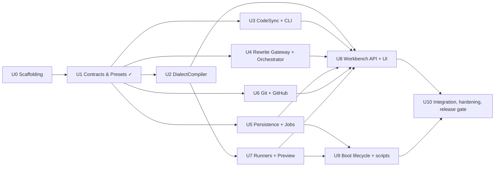

# Implementation Plan: `tech-docs` Pre-Release (`LOCAL-TECH-DOCS-V1-PRE`)

**Status:** Approved. Planning only — no code is written by this document. Delivery is one PR per work unit (§15).
**Guide:** `plan/tech-docs-platform.md` (referred to below as "the Guide").
**Target:** A pre-release build that runs on **localhost only** (single developer machine, single user, all services bound to `127.0.0.1`).

This document turns the Guide's architecture into an ordered, testable set of work units. Where this plan deviates from or adds to the Guide, the change is listed in **§3 Deviations** and referenced inline as `[D#]`.

---

## 1. Pre-Release Definition

"Pre-release on localhost" means the following, and nothing more:

| Concern           | Pre-release stance                                                                                                                                                                                                                         |
| ----------------- | ------------------------------------------------------------------------------------------------------------------------------------------------------------------------------------------------------------------------------------------ |
| Users             | One developer, no authentication, no multi-tenancy                                                                                                                                                                                         |
| Network binding   | Workbench `127.0.0.1:3000`; runners `127.0.0.1:3101/3102/3103`                                                                                                                                                                             |
| Deployment        | `npm run dev` (primary) and `npm run build && npm run start` (must succeed, used as the release gate). No Dockerfile / container image `[D1]`                                                                                              |
| External services | Optional: Google Gemini (`GOOGLE_GENERATIVE_AI_API_KEY`), GitHub (`GITHUB_TOKEN` or `gh auth token`), remote `git clone`. Every external call has an offline adapter so the full workflow can be demonstrated with zero network `[D3][D4]` |
| Persistence       | `.workspaces/workbench.db` (SQLite WAL) + `.workspaces/repos/` + `.workspaces/cache/`, all under the repo root and git-ignored                                                                                                             |
| Platforms         | macOS (arm64/x86_64) and Linux. Windows is not a pre-release target                                                                                                                                                                        |

### 1.1 Pre-release exit criteria (Definition of Done)

1. `npm run setup` on a clean clone installs all workspaces and pre-warms all three runners.
2. `npm run typecheck`, `npm run lint`, and `npm test` pass on a clean clone with no network.
3. `npm run dev` boots the Workbench at `http://localhost:3000` with schema migrated, crash-recovery sweep executed, and runner dependency status reported.
4. The **golden path** below can be completed end-to-end, both (a) fully offline using `DeterministicFakeGateway` + a local `file://` repo and (b) online with Gemini + a GitHub repo:
   1. Add a project (docs repo, optional code repo) → checkout succeeds.
   2. Run a sample rewrite on 3 docs × 5 presets → compare → pick the winner → `doc-style.json` is written.
   3. Run a batch rewrite job across all docs → progress visible → job reaches `completed`.
   4. Preview the rewritten docs in all three engines via iframe.
   5. Run code-sync verification → report shows `clean` / `drift_detected` / `broken_references` correctly on a fixture repo.
   6. Create a PR (online) or a local PR outbox entry (offline).
5. `doc-sync` CLI runs standalone (`npx doc-sync verify`) against a fixture repo with correct exit codes.
6. `next build` succeeds (release gate even though pre-release runs under `next dev`).

---

## 2. Current State Assessment

### 2.1 What exists

| Path                                        | State                                                                                                                                          | Notes                                                                                   |
| ------------------------------------------- | ---------------------------------------------------------------------------------------------------------------------------------------------- | --------------------------------------------------------------------------------------- |
| `package.json` (root)                       | workspaces: `packages/*` only; scripts: `test`, `typecheck`                                                                                    | Must add `apps/*`, `runners/*`, and `dev`/`setup`/`build`/`lint` scripts                |
| `tsconfig.base.json`                        | ES2022 / Bundler resolution / strict                                                                                                           | Good base; keep                                                                         |
| `vitest.config.ts`                          | includes `packages/**/test/**/*.test.ts`                                                                                                       | Extend to `apps/**` and `runners/**` `[D15]`                                            |
| `.gitignore`                                | ignores `.workspaces/`, `node_modules/` (`plan/` was removed from the ignore list so planning docs are tracked)                                | Add `dist/`, `.next/`, runner `content/` dirs, `drizzle/meta` is _kept_                 |
| `packages/core/package.json`                | runtime deps pinned per Guide except **`better-sqlite3` and `drizzle-orm` are missing**; `zod@4.6.7` present (not in Guide table)              | Add missing deps + `yaml`, `diff`, `@types/node`, `drizzle-kit` `[D7]`                  |
| `packages/core/tsconfig.json`               | `"types": []`                                                                                                                                  | Blocks `node:fs`, `node:child_process` etc. Must become `["node"]`                      |
| `packages/core/src/types/index.ts`          | Full interface contract for all six deep modules + 18 error classes. Header says "Wave-2 units (U2-U4) consume but must not modify this file." | Treated as the **frozen contract**. New types go in sibling files `[D10]`               |
| `packages/core/src/styles/presets.ts`       | 5 presets + `doc-style.json` zod schema                                                                                                        | Complete for U1                                                                         |
| `packages/core/test/styles/presets.test.ts` | 10 passing-by-inspection tests                                                                                                                 | Keep; it is the template for test style (expected literals from spec, never recomputed) |
| `plan/.pre-commit-config.yaml`              | `repos: []`                                                                                                                                    | Fill in with local hooks (§10)                                                          |

No `package-lock.json`, no `node_modules`, no `apps/`, no `runners/`, no CLI entrypoint, no DB, no Next app exist yet.

### 2.2 References in the Guide that are not in this repo

The Guide cites "§7", "Q4 spec", and "Module 3" from a larger upstream planning document that was not provided. This plan treats `packages/core/src/types/index.ts` as the authoritative contract wherever the Guide is silent, and §6 of this plan defines the canonical markdown vocabulary that the Guide leaves unspecified.

### 2.3 Environment facts verified in the planning sandbox

| Tool            | Guide (host)      | Sandbox                      | Impact                                                                  |
| --------------- | ----------------- | ---------------------------- | ----------------------------------------------------------------------- |
| Node            | 22.23.3           | 22.21.0                      | None (both ≥ 22.13, so `node:sqlite` is also unflagged as a fallback)   |
| npm             | 10.9.9            | 10.9.4                       | None                                                                    |
| Git             | 2.54.0            | 2.43.0                       | None (worktree + sparse features used are ≥ 2.20)                       |
| Registry access | Available on host | **Not available** in sandbox | Pinned versions in the Guide could not be re-verified here; see `[D14]` |

---

## 3. Deviations From and Additions To the Guide

| ID      | Guide says                                                                                    | This plan does                                                                                                                                                                                                                                                                       | Why                                                                                                                                             |
| ------- | --------------------------------------------------------------------------------------------- | ------------------------------------------------------------------------------------------------------------------------------------------------------------------------------------------------------------------------------------------------------------------------------------ | ----------------------------------------------------------------------------------------------------------------------------------------------- |
| **D1**  | §4: "local-first workbench **and containerized service**"; production/container build path    | No Dockerfile, no container build. `next build` + `next start` remain a release gate but run on localhost                                                                                                                                                                            | Pre-release is localhost-only. Removes an entire test surface                                                                                   |
| **D2**  | §3.2: Git lock uses "an `fcntl`/file-descriptor lockfile" with PID check files                | Lock is a directory/file created with `O_EXCL` (`fs.open(path, 'wx')`) containing `{pid, hostname, acquiredAt}`; stale if PID is dead (`process.kill(pid, 0)` → `ESRCH`) **or** `acquiredAt` older than 10 min; 30 s acquisition timeout with 100 ms polling → `GitLockTimeoutError` | Node has no `fcntl` without a native addon. `O_EXCL` create is atomic on POSIX and needs no dependency                                          |
| **D3**  | `RepoSpec.docsRepoUrl` is a GitHub URL                                                        | Also accepts `file:///abs/path` or an absolute local path. `ensureRepoCheckout` clones from it exactly as from a remote (`git clone --depth 1 <path>`), so the workflow stays identical                                                                                              | Enables zero-network demos and deterministic integration tests                                                                                  |
| **D4**  | `GitHubGateway` → `OctokitGitHubAdapter` only                                                 | Add `LocalOutboxGitHubAdapter` (second adapter per the two-adapter rule): "creates" a PR by writing `.workspaces/pr-outbox/<project>/<branch>.json` and returns a `file://` URL. Selected automatically when no token resolves                                                       | Golden path must complete offline; also gives the seam its deterministic fake                                                                   |
| **D5**  | Diagram: `WB --> DB` (DB is a Workbench concern)                                              | Persistence + job lease machinery live in `packages/core/src/persistence/` and `packages/core/src/jobs/`, exported via subpath `@tech-docs/core/persistence` and `@tech-docs/core/jobs`. Workbench imports them                                                                      | Makes CAS/lease logic unit-testable without Next.js; CLI never imports it (subpath exports keep `better-sqlite3` out of the CLI's import graph) |
| **D6**  | §3.1 describes `batch_jobs` for batch rewrites                                                | `batch_jobs` gains a `kind` column: `'sample_rewrite' \| 'batch_rewrite' \| 'code_sync' \| 'runner_install'`. One lease/heartbeat/recovery implementation serves every long-running operation                                                                                        | Sample rewrites (15 model calls) and code-sync also exceed HTTP request lifetimes; one state machine instead of four                            |
| **D7**  | §1.1 dependency table                                                                         | Add to `@tech-docs/core`: `better-sqlite3@13.0.3`, `drizzle-orm@0.45.4` (in Guide, missing in `package.json`), plus `yaml`, `diff`, `@types/node` (dev), `drizzle-kit` (dev). Keep `zod@4.6.7` (already present, used by presets)                                                    | Required by the design; `yaml` for frontmatter, `diff` for `suggestedEditDiff` and the UI diff view                                             |
| **D8**  | `runners/mdx` unspecified                                                                     | `runners/mdx` is a ~150-line Node HTTP server: compiles `content/**/*.mdx` on request with `@mdx-js/mdx` `evaluate()` + `react-dom/server`, ships a small component set (`Admonition`, `Tabs`, `TabItem`, `CodeBlock`)                                                               | Avoids a third framework; exact-fidelity is only needed for Docusaurus/Starlight                                                                |
| **D9**  | `GrammarParseTimeoutError` (mechanism unspecified)                                            | `web-tree-sitter@0.27` removed `setTimeoutMicros`; use `parser.parse(src, null, { progressCallback })` returning `true` to cancel after 2 s wall-clock                                                                                                                               | API reality for the pinned version                                                                                                              |
| **D10** | `types/index.ts` is frozen                                                                    | Stays frozen except **one additive, optional parameter**: `normalizeToCanonical(rawMarkdown, sourceHint?, filePath?)`. All new types (`JobRecord`, `ProjectRecord`, `CodeRefDirective`, …) live in new files under `src/types/`                                                      | The current signature cannot populate `CanonicalDocInput.filePath`; the change is source-compatible with every existing caller                  |
| **D11** | §4.1: migrations run "before accepting any HTTP connections"                                  | Implemented in `apps/workbench/instrumentation.ts` `register()` (runs once at server start, guarded by `NEXT_RUNTIME === 'nodejs'`), plus a `ensureBooted()` guard awaited at the top of every route handler via a shared `withBoot()` wrapper                                       | Next.js has no pre-listen hook in `next dev`; `register()` is the closest supported point, and the guard makes it airtight                      |
| **D12** | §4.1 step 4: if runner `node_modules` missing, boot "triggers initial workspace installation" | Boot only **verifies** and records `depsInstalled: false`. Installation happens in `npm run setup` or on demand via a `runner_install` job started from the UI                                                                                                                       | Hiding a multi-minute `npm install` inside server boot is a poor localhost experience and can hang `next dev`                                   |
| **D13** | Worker process model implicit                                                                 | Job worker runs **in-process** inside the Next.js server as a `globalThis`-held singleton (survives HMR module reloads). `worker_id = <hostname>:<pid>:<8-char nonce>`                                                                                                               | Single process on localhost; lease expiry already covers crash recovery                                                                         |
| **D14** | Versions verified on host via `npm view`                                                      | Keep Guide pins. First task of U0 runs `npm install`; any pin the registry rejects is replaced by the nearest same-major version and recorded in `plan/version-drift.md`                                                                                                             | Sandbox had no registry access to re-verify                                                                                                     |
| **D15** | `vitest.config.ts` includes only `packages/**`                                                | Include `apps/**/test/**` and `runners/**/test/**`; add a `projects` split so runner/e2e tests are opt-in via `TECH_DOCS_E2E=1`                                                                                                                                                      | Runner tests spawn servers and need installed deps                                                                                              |
| **D16** | Git operations library unspecified                                                            | Shell out to the system `git` via `child_process.execFile` through one `GitCommandRunner` wrapper (with a `RecordingGitRunner` test double)                                                                                                                                          | Zero deps, uses the verified Git binary, trivially fakeable                                                                                     |
| **D17** | UI framework unspecified                                                                      | Next.js App Router + React 19 + Tailwind CSS v4; no component library                                                                                                                                                                                                                | Smallest footprint that still looks presentable for a pre-release demo                                                                          |
| **D18** | Model unspecified                                                                             | Default `gemini-2.5-flash`, overridable by `TECH_DOCS_MODEL`                                                                                                                                                                                                                         | Cost/latency appropriate for 5-way sample comparisons                                                                                           |
| **D19** | `verifyAndSyncDocs` options are fixed by the frozen type                                      | One additive optional field `driftTrigger?: 'signature' \| 'body'` on the `verifyAndSyncDocs` options object in `types/index.ts` (same rule as `[D10]`: optional, source-compatible, recorded in the header note)                                                                    | Lets users trade model cost for catching body-only behaviour changes (§16 option H)                                                             |

---

## 4. Target Repository Layout

```
tech-docs/
├── package.json                     # workspaces: packages/*, apps/*, runners/*
├── tsconfig.base.json
├── vitest.config.ts                 # projects: unit (default) + e2e (opt-in)
├── eslint.config.js                 # NEW: flat config, typescript-eslint
├── .pre-commit-config.yaml          # NEW at root (copied from plan/, filled in)
├── .env.example                     # NEW
├── README.md                        # NEW: setup + golden path
├── scripts/
│   ├── setup.mjs                    # npm install all + prewarm runners + copy WASM
│   ├── prewarm-runners.mjs
│   └── dev.mjs                      # boots workbench (runners are lazy-started)
├── packages/
│   └── core/
│       ├── package.json             # adds bin: doc-sync, exports map
│       ├── drizzle.config.ts
│       ├── drizzle/                 # generated SQL migrations (committed)
│       ├── src/
│       │   ├── index.ts             # public barrel (no persistence/node-only imports)
│       │   ├── types/
│       │   │   ├── index.ts         # FROZEN contract (+ D10 optional param)
│       │   │   ├── persistence.ts   # JobRecord, ProjectRecord, JobKind, JobStatus …
│       │   │   └── directives.ts    # CodeRefDirective, AdmonitionKind, TabSpec …
│       │   ├── styles/presets.ts    # exists
│       │   ├── dialect/             # U2
│       │   │   ├── DialectCompiler.ts
│       │   │   ├── canonical/       # parse, validate, directive vocabulary
│       │   │   ├── adapters/{Mdx,Docusaurus,Starlight}DialectAdapter.ts
│       │   │   └── frontmatter.ts
│       │   ├── codesync/            # U3
│       │   │   ├── CodeSymbolIndexer.ts
│       │   │   ├── extractors/{TsJs,Python,Go}SymbolExtractor.ts
│       │   │   ├── wasm/loader.ts
│       │   │   ├── DocSyncEngine.ts
│       │   │   ├── manifest.ts      # doc-sync.lock.json read/write/validate
│       │   │   └── hashing.ts
│       │   ├── rewrite/             # U4
│       │   │   ├── RewriteOrchestrator.ts
│       │   │   ├── gateways/{VercelAiSdk,DeterministicFake}Gateway.ts
│       │   │   ├── prompts.ts
│       │   │   ├── validators.ts    # canonical + MDX + link validation
│       │   │   └── semaphore.ts
│       │   ├── persistence/         # U5
│       │   │   ├── db.ts            # open + PRAGMAs + migrate
│       │   │   ├── schema.ts        # drizzle schema
│       │   │   └── repositories/{projects,jobs,samples,syncReports,prs}.ts
│       │   ├── jobs/                # U5
│       │   │   ├── JobStore.ts      # CAS transitions (lease, heartbeat, finish, cancel, recover)
│       │   │   ├── JobWorker.ts     # in-process executor + heartbeat + AbortController
│       │   │   ├── handlers/{sampleRewrite,batchRewrite,codeSync,runnerInstall}.ts
│       │   │   └── SqliteJobProgressSink.ts
│       │   ├── git/                 # U6
│       │   │   ├── GitCommandRunner.ts (+ RecordingGitRunner)
│       │   │   ├── RepoLock.ts
│       │   │   ├── GitWorkspaceManager.ts
│       │   │   ├── scaffolding/{docusaurus,starlight,mdx}.ts
│       │   │   └── github/{OctokitGitHubAdapter,LocalOutboxGitHubAdapter,tokenResolver}.ts
│       │   ├── preview/             # U7
│       │   │   ├── PreviewRunnerManager.ts
│       │   │   ├── RunnerProcess.ts  # spawn / health / shutdown
│       │   │   ├── contentSync.ts    # mutex + tmp+fsync+rename + prune
│       │   │   └── engines/{mdx,docusaurus,starlight}.ts  # paths, URL mapping, health URL
│       │   ├── cli/                 # U3
│       │   │   ├── doc-sync.ts      # bin entry
│       │   │   └── commands/{index,bind,verify}.ts
│       │   └── config/
│       │       ├── env.ts           # zod-validated env
│       │       └── paths.ts         # .workspaces resolution
│       └── test/
│           ├── fixtures/            # markdown docs, sample repos (ts/py/go), engine expectations
│           └── **/*.test.ts
├── apps/
│   └── workbench/                   # U8 — @tech-docs/workbench
│       ├── next.config.ts           # serverExternalPackages: better-sqlite3, web-tree-sitter
│       ├── instrumentation.ts       # boot lifecycle (D11)
│       ├── app/
│       │   ├── layout.tsx, page.tsx (projects)
│       │   ├── projects/[id]/{page,style,jobs,jobs/[jobId],preview,sync}/page.tsx
│       │   ├── settings/page.tsx
│       │   └── api/**/route.ts
│       ├── components/
│       ├── lib/{boot,services,api-client}.ts
│       └── test/
└── runners/
    ├── mdx/                         # @tech-docs/runner-mdx      port 3101 (D8)
    ├── docusaurus/                  # @tech-docs/runner-docusaurus port 3102
    └── starlight/                   # @tech-docs/runner-starlight  port 3103
        (each: package.json, engine config, content/ (git-ignored), /__health endpoint or static probe)
```

---

## 5. Work Units and Sequencing

Work units follow the existing "Wave / U#" convention from `types/index.ts`. Within a wave, units are independent and can proceed in parallel; a wave starts when the previous wave's **blocking** units are merged. Effort is in engineer-days and is an estimate.



| Wave | Units              | Blocking for next wave |
| ---- | ------------------ | ---------------------- |
| 1    | U0, U1 (done)      | U0                     |
| 2    | U2, U3, U4, U5, U6 | all                    |
| 3    | U7, U9             | U7                     |
| 4    | U8                 | U8                     |
| 5    | U10                | —                      |

---

### U0 — Monorepo scaffolding and tooling (Wave 1, ~1.5 d)

**Modifies existing code:** `package.json`, `packages/core/package.json`, `packages/core/tsconfig.json`, `vitest.config.ts`, `.gitignore`, `plan/.pre-commit-config.yaml`.

Tasks:

1. Root `package.json`: `workspaces: ["packages/*", "apps/*", "runners/*"]`; scripts:
   - `build` → `npm run build --workspaces --if-present` (workspace order = `packages/*` before `apps/*`, so core builds before workbench)
   - `test` (`vitest run --project unit`), `test:watch`, `test:e2e` (`TECH_DOCS_E2E=1 vitest run --project e2e`)
   - `typecheck` → `npm run typecheck --workspaces --if-present` (each workspace owns its tsconfig)
   - `lint`, `lint:fix`, `format`, `format:check`, `db:generate` (`drizzle-kit generate` in core)
   - `engines: { node: ">=22.13" }`
   - **Deferred to U9** (their targets `scripts/setup.mjs`, `scripts/dev.mjs`, `apps/workbench` are created there): `setup`, `dev`, `start`
2. `packages/core/package.json`: add deps `[D7]`; `"exports"` map seeded with `"."` only (subpaths `"./persistence"`, `"./jobs"`, `"./git"`, `"./preview"` are appended by U5/U6/U7; `"bin": { "doc-sync": … }` is added by U3). Add `build: tsc -p tsconfig.build.json`, `clean`, `db:generate`. Create `src/index.ts` barrel (append-only; never re-exports Node-only modules).
3. `packages/core/tsconfig.json`: `"types": ["node"]`; add `tsconfig.build.json` excluding `test/`.
4. `vitest.config.ts`: two projects — `unit` (`packages/**`, `apps/**` excluding `*.e2e.test.ts`) and `e2e` (`**/*.e2e.test.ts`, only when `TECH_DOCS_E2E=1`) `[D15]`.
5. ESLint flat config (typescript-eslint recommended, `import/extensions` off, `no-floating-promises` on). Prettier with a shared config.
6. Move `plan/.pre-commit-config.yaml` → root `.pre-commit-config.yaml` with local hooks: `npm run lint`, `npm run typecheck`, `npm test -- --changed` (see §10).
7. `.gitignore` additions: `dist/`, `.next/`, `runners/*/content/`, `runners/docusaurus/.docusaurus/`, `runners/starlight/.astro/`, `.env`, `*.tsbuildinfo`.
8. `.env.example` listing every variable in §9.
9. `npm install` → commit `package-lock.json`. Record any pin substitutions in `plan/version-drift.md` `[D14]`, then run `npm run format` once (the `.prettierrc.json` `printWidth: 120` reflows the long lines in `styles/presets.ts`; commit that in the same PR).

Acceptance: `npm install && npm run typecheck && npm run lint && npm test` passes on a clean clone; the existing presets test still passes unmodified.

**Status:** complete. Steps 1–9 done; acceptance gate (`npm run typecheck && npm run lint && npm test` → 18/18 tests) passed on the host on 2026-10-26 with `typescript-eslint@8.72.0` (see `plan/version-drift.md`). ESLint `projectService` uses `allowDefaultProject: ['*.config.ts']` for root tooling configs. Ready to open PR `unit/U0-scaffolding` (include `package-lock.json` and the one-time Prettier reflow of `styles/presets.ts`, `types/index.ts`, and the test).

---

### U1 — Contracts & presets (Wave 1, done)

Already implemented. Only change: `[D10]` optional `filePath` param on `DialectCompiler.normalizeToCanonical` — **applied** (with a header comment recording it as the sole approved amendment). Add `src/types/persistence.ts` and `src/types/directives.ts` as part of U5/U2 respectively.

---

### U2 — `DialectCompiler` deep module (Wave 2, ~4 d)

**Interface (frozen):** `normalizeToCanonical`, `compileCanonicalMarkdown`.
**Seam:** `DialectAdapter` with three adapters `MdxDialectAdapter`, `DocusaurusDialectAdapter`, `StarlightDialectAdapter`.

Implementation:

1. **Canonical pipeline** (`canonical/parse.ts`): `unified().use(remarkParse).use(remarkFrontmatter, ['yaml']).use(remarkDirective).use(remarkMdx)` → mdast. Frontmatter parsed with `yaml`; invalid YAML → `FrontmatterValidationError`.
2. **Directive vocabulary** (§6) validated in `canonical/validate.ts`; unknown container/leaf directive → `UnsupportedDirectiveError` (with line). Parse failure → `DialectParseError`.
3. **`normalizeToCanonical(raw, sourceHint, filePath)`**: detect dialect if no hint (heuristics: `import Tabs from '@theme/Tabs'` → docusaurus; `@astrojs/starlight/components` → starlight; `sidebar_position` → docusaurus; `sidebar.order` → starlight). Per-source normalizers rewrite engine-specific JSX (`<Tabs>/<TabItem>`, `<Aside>`, `<Admonition>`) and frontmatter keys back to canonical directives/keys; strip engine-only imports. Output: `CanonicalDocInput`.
4. **`compileCanonicalMarkdown(input, target)`**: parse → validate → adapter transforms mdast (directives → engine constructs, frontmatter → engine keys, collect `synthesizedImports`) → `remark-stringify` (+ `remark-mdx` serializer) → prepend imports after frontmatter → `DialectCompileResult` with diagnostics.
5. **Adapter mapping** (authoritative table in §6.3).
6. **Stability**: stringify options fixed (`bullet: '-'`, `fences: true`, `emphasis: '_'`, `rule: '-'`) so the output is byte-stable across runs (tests assert idempotence: `compile(normalize(compile(x))) === compile(x)`).

Tests (`test/dialect/`):

- Golden fixtures: `fixtures/dialect/<case>/canonical.md` + `expected.{mdx,docusaurus,starlight}.mdx`; one case per directive type, frontmatter variants, nested admonitions in tabs, code-ref blocks.
- Round-trip normalize→compile idempotence per engine.
- Error cases: unknown directive, broken YAML, unclosed container → typed errors with line numbers.
- Starlight `title` missing → diagnostic `error` (Starlight requires it), Docusaurus/MDX → `warn`.

---

### U3 — `CodeSymbolIndexer`, `DocSyncEngine`, `doc-sync` CLI (Wave 2, ~5.5 d)

**Interface (frozen):** `DocSyncEngine.indexRepositorySymbols / bindDocReferences / verifyAndSyncDocs`.
**Seam:** `SymbolExtractor` with `TsJsSymbolExtractor`, `PythonSymbolExtractor`, `GoSymbolExtractor`.

Implementation:

1. **WASM loader** (`wasm/loader.ts`): `Parser.init({ locateFile })` pointing at `web-tree-sitter/tree-sitter.wasm`; grammar files resolved from `tree-sitter-wasms/out/tree-sitter-{typescript,tsx,javascript,python,go}.wasm` via `createRequire(import.meta.url).resolve`. Cached per language. Load failure → `WasmGrammarLoadError`. **Spike first (0.5 d):** confirm `tree-sitter-wasms@0.1.13` grammar ABI loads under `web-tree-sitter@0.27.1`; fallback is to vendor grammars built with `tree-sitter build --wasm` into `packages/core/wasm/` and document it as a deviation.
2. **Extractors**: tree-sitter queries per language producing `SymbolRecord`s:
   - TS/JS: `function_declaration`, `class_declaration`, `method_definition`, `interface_declaration`, `type_alias_declaration`, exported `lexical_declaration` (→ `variable`), arrow functions assigned to `const`.
   - Python: `function_definition`, `class_definition`, methods (function inside class body) → `method`.
   - Go: `function_declaration`, `method_declaration` (receiver prefix in name: `Type.Method`), `type_spec` (struct → `class`, interface → `interface`, others → `type`).
   - **Name resolution rules** (§16): symbol keys are qualified — `Class.method` (TS/JS/Python), `Type.Method` for Go receivers; TS/JS overload groups and Go/Python same-name re-definitions resolve to the **first** declaration unless `index=n` is given on the directive; `export { x as y }` re-exports and Python `from x import y` are **not** followed (documented limitation, surfaced as `MissingCodeReferenceError` with a hint).
   - `signatureText` = node text up to (not including) the body; whitespace-collapsed. `signatureHash`/`bodyHash` = `sha256` hex prefixed `sha256:`. Key in `SymbolTable` = `<relativeFile>#<symbolName>`.
   - Parse timeout 2 s via `progressCallback` → `GrammarParseTimeoutError` `[D9]`.
   - File walk ignores `node_modules`, `.git`, `dist`, `build`, `vendor`, `__pycache__`, files > 1 MiB.
3. **Region support**: `// #region name` / `// #endregion` (TS/JS/Go) and `# region name` / `# endregion` (Python) produce pseudo-symbols `region:name`.
   3b. **Hash-only fallbacks** (§16 options C + D, for files without a supported grammar): `::code-ref{file lines="10-20"}` captures the given line range; `::code-ref{file}` with no selector captures the whole file. Both record `bodyHash` only (`signatureHash` = `bodyHash`), are verified purely by hash, report `stale` when changed and `broken` when the file is missing, and are **never auto-relocated** (the snippet is refreshed from the same range under `autoWriteSnippets`, and the report flags that the author must re-check the range). `lines=` on a file that _does_ have a grammar is allowed but emits a `warn` diagnostic recommending `symbol=`.
4. **`bindDocReferences`**: find `::code-ref{...}` leaf directives (§6.2); resolve symbol/region; insert or replace the fenced snippet block immediately following the directive; write `hash` attribute; build `DocSyncLockManifest`. Unresolved → `MissingCodeReferenceError` collected into manifest as not tracked and returned in diagnostics (engine does not throw for one bad ref).
5. **`verifyAndSyncDocs`**: load manifest (`<docRootDir>/doc-sync.lock.json`, schema-validated with zod; invalid → `CorruptLockfileError`); re-index; classify each tracked reference: same hashes → verified; symbol missing → broken; `bodyHash` changed only → snippet stale (auto-rewritten when `autoWriteSnippets`); `signatureHash` changed → drift candidate (with `driftTrigger: 'body'` `[D19]`, a `bodyHash`-only change is also a drift candidate; default `'signature'`). For drift candidates with a `gateway`, compute `codeDiffPatch` via `git diff <base>..<head> -- <file>` (or `git diff HEAD` when SHAs omitted) and call `evaluateProseDrift`. Result → `SyncReport`; manifest rewritten with new `lastVerifiedAt` when `autoWriteSnippets`.
6. **CLI** (`cli/doc-sync.ts`, no CLI framework; hand-rolled arg parsing): `doc-sync index <root> [--lang ts,py,go] [--json]`, `doc-sync bind <docsRoot> --code <root>`, `doc-sync verify --code <root> --docs <docsRoot> [--write] [--base SHA --head SHA] [--drift-on-body] [--json] [--fake-gateway]`. Exit codes: `0` clean, `1` drift_detected, `2` broken_references, `3` usage/runtime error.
7. **CI recipe** (docs only, no code): `README.md` section plus `packages/core/ci-examples/doc-sync.yml` — a GitHub Actions workflow that runs `doc-sync verify --base ${{ github.event.pull_request.base.sha }} --head ${{ github.sha }} --json` in the **code** repo on every PR, and a `.pre-commit-config.yaml` snippet for the docs repo, so drift is caught at the source rather than only when the workbench is opened (§16).

Tests (`test/codesync/`):

- Fixture repos `fixtures/repos/{ts-sample,py-sample,go-sample}` with known symbol lists (expected literals in tests).
- Hash stability: reformatting whitespace inside a body changes `bodyHash` but not `signatureHash`; renaming a parameter changes both.
- `bindDocReferences` golden output.
- `verifyAndSyncDocs` scenarios: clean / body-only change / signature change (with `DeterministicFakeGateway`) / deleted symbol / corrupt manifest / `driftTrigger: 'body'` promotes a body-only change to a drift candidate.
- Name resolution: `Class.method` and Go `Type.Method` keys; overloads → first declaration and `index=2` → second; re-export → `MissingCodeReferenceError` with hint.
- Hash-only fallbacks: `lines=` range and whole-file refs on a `.rs` fixture (no grammar) → verified / stale / broken; no relocation attempted; `lines=` on a `.ts` file → `warn` diagnostic.
- CLI exit-code tests via `execFile` on the built CLI (unit project builds core first via `globalSetup`).

---

### U4 — `RewriteModelGateway` adapters and `RewriteOrchestrator` (Wave 2, ~4 d)

**Interface (frozen):** `RewriteOrchestrator.runSampleRewrite / runBatchRewrite`, `RewriteModelGateway`.
**Seam:** `VercelAiSdkGateway` (prod) and `DeterministicFakeGateway` (test/offline).

Implementation:

1. **`VercelAiSdkGateway`**: `generateText` from `ai@7` with `google(model)` from `@ai-sdk/google`; system prompt = base rules + `preset.systemPromptModifiers` + `structuralRules` + `userGuidance` + `docGraphSummary` + optional `styleExemplar` + optional `repairErrorContext`; output must be a single fenced markdown document — gateway strips the outer fence. Retry policy: 429/`RESOURCE_EXHAUSTED` → `ModelRateLimitError`, exponential backoff 1 s/2 s/4 s/8 s with jitter, max 4 → `MaxRetriesExceededError`. `AbortSignal` plumbed through for lease-loss cancellation. `evaluateProseDrift` uses `generateObject`/zod schema for `{ needsChange, suggestedEditDiff, explanation }` → `null` when `needsChange=false`.
2. **`DeterministicFakeGateway`**: pure function of inputs. Produces a recognisable, valid canonical document per preset (e.g. prepends `<!-- preset:<id> -->` comment and applies a fixed structural template around the original headings), so sample comparison in the UI is visibly different per preset. Optional `failOn: (filePath) => 'invalid-mdx' | 'throw' | null` knob for repair/failure tests. `evaluateProseDrift` returns a canned recommendation when `previousSignature !== currentSignature`.
3. **Validators** (`validators.ts`): `canonicalAstValid` via U2 parse+validate; `mdxValid` via `@mdx-js/mdx` `compile()` with `remarkFrontmatter` + `remarkDirective`; relative link check against the set of doc paths in the request → `BrokenLinkValidationError` message collected into `validationErrors` (non-fatal for samples; fatal for batch after repair).
4. **`runSampleRewrite`**: `files × presets` tasks through a semaphore (max 5); each → `SampleCandidateResult`. Never throws for a single candidate failure; records errors in `validationErrors`.
5. **`runBatchRewrite`**: semaphore `maxConcurrency ?? 5`; per file: `sink.onFileStarted` → generate → validate → if invalid, one repair call with `repairErrorContext` (counts in `repairedFiles` on success) → `sink.onFileCompleted` or `sink.onFileFailed`. Honors `AbortSignal` (added as optional field on an internal options object, not on the frozen type). Returns `BatchRewriteReport`.
6. `docGraphSummary` builder: list of doc paths + H1 titles + outbound links (≤ 4 KB), built by the caller (U8) using U2's parser.

Tests (`test/rewrite/`):

- Orchestrator with fake gateway: counts, ordering independence, concurrency ceiling (assert max in-flight ≤ 5 with an instrumented gateway), repair path, failure path, abort mid-batch.
- Gateway retry logic with an injected fake `generateText` throwing 429 twice then succeeding; exhausts → `MaxRetriesExceededError`.
- Validators: invalid JSX, broken relative link, unknown directive.
- No test calls the real Gemini API.

---

### U5 — Persistence, job store, in-process worker (Wave 2, ~4 d)

**Location:** `packages/core/src/{persistence,jobs}` `[D5]`.

Schema (`schema.ts`, drizzle + `drizzle-kit generate` → committed SQL in `packages/core/drizzle/`):

| Table              | Key columns                                                                                                                                                                                                                                                                                                                                                                                                                           |
| ------------------ | ------------------------------------------------------------------------------------------------------------------------------------------------------------------------------------------------------------------------------------------------------------------------------------------------------------------------------------------------------------------------------------------------------------------------------------- |
| `projects`         | `id` (text, nanoid), `name`, `docs_repo_url`, `docs_repo_branch`, `code_repo_url?`, `code_repo_branch?`, `docs_local_path`, `code_local_path?`, `docs_root_dir` (e.g. `docs/`), `detected_engine?`, `created_at`, `updated_at`                                                                                                                                                                                                        |
| `style_selections` | `project_id` PK/FK, `preset_id`, `user_guidance?`, `sample_file_paths` (json), `chosen_at`                                                                                                                                                                                                                                                                                                                                            |
| `batch_jobs`       | `id`, `project_id` FK, `kind` `[D6]`, `status` (`queued\|running\|completed\|failed\|cancelled`), `worker_id?`, `locked_at?`, `lease_expires_at?`, `error_code?`, `error_message?`, `params` (json), `result` (json, e.g. `SyncReport` or `BatchRewriteReport` minus contents), `total_files`, `completed_count`, `failed_count`, `branch_name?`, `worktree_path?`, `created_at`, `updated_at`; index on `(status, lease_expires_at)` |
| `batch_job_files`  | `id`, `job_id` FK cascade, `file_path`, `preset_id?`, `status`, `original_content?`, `rewritten_content?`, `canonical_ast_valid?`, `mdx_valid?`, `validation_errors` (json), `repaired` (int), `error?`, `started_at?`, `finished_at?`; unique `(job_id, file_path, preset_id)`                                                                                                                                                       |
| `pull_requests`    | `id`, `project_id`, `job_id`, `pr_number`, `pr_url`, `branch_name`, `created_at`                                                                                                                                                                                                                                                                                                                                                      |

Timestamps are ISO-8601 UTC text (`strftime('%Y-%m-%dT%H:%M:%fZ','now')`), matching the Guide's SQL so lexicographic comparison is valid.

Implementation:

1. `db.ts`: `openDatabase(path)` → `better-sqlite3` + the four PRAGMAs from Guide §3.1 in that order → `migrate()` from `drizzle-orm/better-sqlite3/migrator` → returns drizzle instance. Singleton per path. `:memory:` supported for tests.
2. `JobStore.ts` — raw SQL exactly as in Guide §3.1 (via `db.run(sql\`…\`)`), each returning `changes`:
   - `enqueue(kind, projectId, params, files[])`
   - `acquireLease(jobId, workerId)` → `changes === 0` ⇒ `JobAlreadyStartedError` (new error class in `types/persistence.ts`; mapped to HTTP 409)
   - `renewLease(jobId, workerId)` → `false` when fenced out
   - `finish(jobId, workerId, status, errorCode?, errorMessage?, result?)`
   - `cancel(jobId)`: `queued → cancelled` directly; `running → ` sets `cancel_requested = 1` (added column), worker observes on next heartbeat and finishes as `cancelled`
   - `recoverExpiredLeases()` — Guide's sweep query; returns count
   - `claimNextQueued(workerId)` — `UPDATE … WHERE id = (SELECT id FROM batch_jobs WHERE status='queued' ORDER BY created_at LIMIT 1) AND status='queued'`
3. `JobWorker.ts`: `globalThis.__techDocsJobWorker` singleton `[D13]`; `start(jobId)` acquires lease, sets `AbortController`, heartbeat `setInterval(30 s)` → on `renewLease === false` aborts and stops; dispatches to handler by `kind`; handlers receive `{ db, job, signal, services }`; `finally` clears interval. `drainQueue()` polls every 5 s for `queued` jobs (so jobs enqueued while the worker was busy still run).
4. `SqliteJobProgressSink` implements `JobProgressSink` updating `batch_job_files` and `batch_jobs` counters in one transaction per callback.
5. Handlers are thin: `batchRewrite` wires U4 + sink, then (under the repo lock) runs `bindDocReferences` when a code repo exists, writes rewritten docs + `doc-style.json` + `doc-sync.lock.json` into the job worktree, commits, and pushes the branch (§13 decisions 1 & 2; push failure is recorded in `result.push`, not fatal); `sampleRewrite` stores candidates into `batch_job_files` (one row per file×preset); `codeSync` wires U3 and stores `SyncReport` in `result`; `runnerInstall` runs `npm install` in the runner dir via `execFile` with streamed log to `result`.

Tests (`test/persistence/`, `test/jobs/`, temp-file DBs):

- PRAGMAs applied (`journal_mode` returns `wal`).
- Migration idempotence (open twice).
- **CAS**: two concurrent `acquireLease` calls → exactly one `changes === 1`, the other throws `JobAlreadyStartedError`.
- Heartbeat fencing: expire the lease manually, run `recoverExpiredLeases`, then `renewLease` returns `false` and `finish` affects 0 rows.
- Recovery sweep marks only expired `running` rows as `failed/WORKER_CRASH_EXPIRED`.
- Worker: runs a fake handler, heartbeats (with fake timers), aborts on lost lease, honors cancel.

---

### U6 — `GitWorkspaceManager` and `GitHubGateway` (Wave 2, ~3.5 d)

**Interface (frozen):** `ensureRepoCheckout`, `acquireRepoLock`, `createRewritePullRequest`; `GitHubGateway`.
**Seams:** `GitCommandRunner` (`ExecGitRunner` / `RecordingGitRunner`) `[D16]`; `GitHubGateway` (`OctokitGitHubAdapter` / `LocalOutboxGitHubAdapter`) `[D4]`.

Implementation:

1. `RepoLock.ts` `[D2]`: `withRepoLock(lockPath, fn, { timeoutMs: 30_000 })`. Boot-time sweep (`sweepStaleLocks(reposDir)`) removes locks whose PID is dead.
2. `GitWorkspaceManager.ensureRepoCheckout(spec)`: paths `.workspaces/repos/<projectId>/{docs,code}`; if absent → `git clone --depth 1 --branch <b> <url> <path>` (URL may be `file://`/absolute path `[D3]`); if present → `git fetch --depth 1 origin <b> && git checkout -B <b> origin/<b>` (discarding local changes is acceptable: all edits happen in worktrees). Auth failures (`fatal: Authentication failed`, `could not read Username`) → `GitAuthError`; other non-zero → `GitCloneError`. Every mutation wrapped in `acquireRepoLock`. Returns `LocalRepoHandle`.
3. Worktree helper `createJobWorktree(handle, branch, jobId)` → `.workspaces/repos/<projectId>/worktrees/<jobId>` via `git worktree add -b <branch>`; `writeFilesAtomically(worktree, Map)` uses the same tmp+fsync+rename helper as U7; `removeJobWorktree` on cleanup.
4. `createRewritePullRequest(req, gh)`: inside the lock: worktree (if not already created by the batch handler) → write rewritten files → optional engine scaffolding (`includeEngineScaffolding`: writes minimal `docusaurus.config.ts`/`astro.config.mjs`/`package.json` additions from `scaffolding/`) → `git add -A && git commit -m` (no-op if the batch handler already committed) → `git push -u origin <branch>` (idempotent; retries a push that failed at job completion) → `gh.createPullRequest({ owner, repo, head: branch, base: spec.docsRepoBranch ?? default })`. `owner/repo` parsed from the remote URL (https or ssh); for `file://` remotes the push targets the local bare/regular repo and the outbox adapter is used.
5. `tokenResolver.ts`: `GITHUB_TOKEN` env → `gh auth token` (execFile) → `GitAuthError`. `OctokitGitHubAdapter`: `@octokit/rest` `pulls.create`, `pulls.createReviewComment`; 403 with `x-ratelimit-remaining: 0` → `GitHubApiRateLimitError`.
6. `LocalOutboxGitHubAdapter`: writes JSON to `.workspaces/pr-outbox/`, increments a local counter for `prNumber`, returns `file://` URL; `postReviewComment` appends to the same file.

Tests (`test/git/`):

- Lock: contention timeout → `GitLockTimeoutError` within 30 s using fake timers; stale PID lock is reclaimed.
- `ensureRepoCheckout` against a temp repo created with `git init` + commit (no network); re-run is idempotent and fetches.
- `createRewritePullRequest` end-to-end against a temp **bare** origin + `LocalOutboxGitHubAdapter`; assert branch exists in origin and outbox file content.
- `RecordingGitRunner` asserts exact git argv sequences for error-mapping cases.
- Octokit adapter tested with an injected fake Octokit instance (no network).

---

### U7 — Runners and `PreviewRunnerManager` (Wave 3, ~5 d)

**Interface (frozen):** `getRunnerStatus`, `ensureRunnerStarted`, `resolvePreviewUrl`, `syncPreviewContent`, `shutdownAllRunners`.
**Seam:** `RunnerEngine` descriptors (`engines/{mdx,docusaurus,starlight}.ts`) + `RunnerProcess` (`SpawnedRunnerProcess` / `FakeRunnerProcess`).

Runner workspaces:

| Runner               | Package                                                                                                                     | Port | Content dir                                                                                                      | Dev command                                               | Health probe          |
| -------------------- | --------------------------------------------------------------------------------------------------------------------------- | ---- | ---------------------------------------------------------------------------------------------------------------- | --------------------------------------------------------- | --------------------- |
| `runners/mdx` `[D8]` | `@tech-docs/runner-mdx` (`@mdx-js/mdx@3.1.1`, `react`, `react-dom`, `remark-directive`, `remark-frontmatter`, `remark-gfm`) | 3101 | `content/`                                                                                                       | `node server.mjs --port 3101 --host 127.0.0.1`            | `GET /__health` → 200 |
| `runners/docusaurus` | `@tech-docs/runner-docusaurus` (`@docusaurus/core@3.10.2`, `@docusaurus/preset-classic`)                                    | 3102 | `docs/` (configured as content root; `content/` symlink avoided — the manager writes to `docs/` for this engine) | `docusaurus start --port 3102 --host 127.0.0.1 --no-open` | `GET /` → 200         |
| `runners/starlight`  | `@tech-docs/runner-starlight` (`astro`, `@astrojs/starlight@0.42.7`)                                                        | 3103 | `src/content/docs/`                                                                                              | `astro dev --port 3103 --host 127.0.0.1`                  | `GET /` → 200         |

Each runner ships one placeholder `index.md(x)` so the dev server starts with an empty content set, and a `README.md` stating it is never run in production.

Implementation:

1. `engines/*.ts`: `{ engine, port, cwd, contentDir, command, args, healthPath, urlFor(canonicalPath) }`. URL mapping: canonical `guides/setup.md` → mdx `/guides/setup`, docusaurus `/docs/guides/setup` (respecting `id`/`slug` frontmatter when present), starlight `/guides/setup/`.
2. `RunnerProcess.ts`: before spawn, probe the port (`net.createServer().listen`) → `RunnerPortConflictError` if taken by a foreign process (the manager's own healthy runner is reused). Spawn with `stdio: pipe`, ring-buffer last 200 log lines (exposed via `GET /api/preview/runners/:engine/logs`). Poll health every 500 ms up to 90 s (Docusaurus cold start) → `RunnerStartTimeoutError`. `exit` event → status `crashed`. `shutdownAllRunners` sends `SIGTERM`, waits 5 s, `SIGKILL`; also registered on `process.on('SIGINT'|'SIGTERM')` and `beforeExit` in the Workbench boot.
3. `PreviewRunnerManager`: `globalThis` singleton; `runnerLocks: Map<engine, AsyncMutex>`; `ensureRunnerStarted` is idempotent and coalesces concurrent callers on the same start promise; `getRunnerStatus` returns `depsInstalled` as extra field in a wrapper (frozen `RunnerStatus` untouched; UI reads the wrapper).
4. `contentSync.ts` (Guide §3.3 verbatim): inside the engine mutex — for each `RenderedFileMap` entry: `mkdir -p`, write `content/<dir>/.tmp.<name>.<nonce>`, `fsync`, `rename` over target; then unlink previously-synced files absent from the new map (tracked in `.workspaces/cache/preview-manifest-<engine>.json`), never removing the content root directory. Filesystem errors → `ContentSyncFilesystemError`. Returns `{ syncedCount, timestamp }`.

Tests (`test/preview/` unit; `*.e2e.test.ts` opt-in):

- `contentSync` on a temp dir: no `.tmp.*` leftovers, prune works, concurrent `syncPreviewContent` calls serialize (instrumented order), root inode unchanged.
- URL mapping table tests (expected literals).
- `FakeRunnerProcess`: start coalescing, timeout → `RunnerStartTimeoutError`, crash → `crashed` status, port conflict → `RunnerPortConflictError`.
- E2E (opt-in): start each real runner, sync one fixture doc compiled by U2, fetch the page, assert the admonition/tab markup is present, shut down.

---

### U8 — Workbench application (Wave 4, ~7 d)

`apps/workbench` — `@tech-docs/workbench`, Next.js `16.4.3`, React 19, Tailwind v4 `[D17]`. `next.config.ts`: `serverExternalPackages: ['better-sqlite3', 'web-tree-sitter', '@tech-docs/core']`, `transpilePackages` not used (core is consumed from `dist/` via exports; `npm run dev` runs `tsc --watch` for core in parallel — see U9).

**Service layer** (`lib/services.ts`): a `globalThis`-held container `{ db, jobStore, worker, gitManager, previewManager, dialectCompiler, docSyncEngine, orchestrator, gateway, github }` created by `lib/boot.ts`. Gateway selection: `TECH_DOCS_GATEWAY=google|fake`, default `google` when `GOOGLE_GENERATIVE_AI_API_KEY` set else `fake`; GitHub adapter similarly by token presence `[D4]`.

**API routes** (all under `app/api/`, JSON, errors mapped: typed core errors → `{ error: { code, message } }` with 4xx; `JobAlreadyStartedError` → 409, `GitLockTimeoutError` → 423, `RunnerPortConflictError` → 409, `*RateLimit*` → 429, unknown → 500):

| Method & path                                                                                      | Purpose                                                                                                                                                                 |
| -------------------------------------------------------------------------------------------------- | ----------------------------------------------------------------------------------------------------------------------------------------------------------------------- |
| `GET /api/health`                                                                                  | DB ok, migrations version, gateway mode, github mode, runner statuses, env warnings                                                                                     |
| `GET/POST /api/projects`                                                                           | list / create (`RepoSpec` + `name`, `docsRootDir`) — create enqueues nothing; checkout is explicit                                                                      |
| `GET /api/projects/:id`                                                                            | project + style selection + latest jobs                                                                                                                                 |
| `POST /api/projects/:id/checkout`                                                                  | `ensureRepoCheckout` (synchronous; shallow clones are fast; 423 on lock timeout)                                                                                        |
| `GET /api/projects/:id/docs`                                                                       | doc tree under `docsRootDir` (`.md`/`.mdx`), with detected engine and H1                                                                                                |
| `GET /api/projects/:id/docs/content?path=`                                                         | raw + canonical (normalized) content                                                                                                                                    |
| `POST /api/projects/:id/jobs`                                                                      | enqueue `{ kind, params }` → `201 { jobId }`                                                                                                                            |
| `POST /api/jobs/:id/start`                                                                         | `acquireLease` → `202` or `409`                                                                                                                                         |
| `POST /api/jobs/:id/cancel`                                                                        | cancel                                                                                                                                                                  |
| `GET /api/jobs/:id`                                                                                | job + counters; `?files=1` includes per-file rows (without contents)                                                                                                    |
| `GET /api/jobs/:id/files/:fileId`                                                                  | original + rewritten + unified diff (via `diff`)                                                                                                                        |
| `PUT /api/projects/:id/style`                                                                      | `{ presetId, userGuidance }` → DB row + writes `doc-style.json` at docs root via lock (committed later with the batch PR)                                               |
| `POST /api/projects/:id/preview/sync`                                                              | `{ engine, source: 'job' \| 'checkout', jobId? }` → compile each doc via U2 → `ensureRunnerStarted` → `syncPreviewContent` → `{ previewUrl, syncedCount, diagnostics }` |
| `GET /api/preview/runners`, `POST /api/preview/runners/:engine/{start,stop,install}`, `GET …/logs` | runner control                                                                                                                                                          |
| `POST /api/jobs/:id/pr`                                                                            | `{ branchName, prTitle, prBody, includeEngineScaffolding, engineToScaffold }` → `createRewritePullRequest`                                                              |

**Pages** (server components for data, small client components for polling/forms; polling interval 2 s via `fetch` — no websockets):

| Route                         | Content                                                                                                                                                                                                      |
| ----------------------------- | ------------------------------------------------------------------------------------------------------------------------------------------------------------------------------------------------------------ |
| `/`                           | Project list; "Add project" form (docs URL/path, branch, optional code URL/path, docs root dir); gateway/github mode badges                                                                                  |
| `/projects/[id]`              | Checkout status + button; doc tree; detected engine; current style selection; quick links                                                                                                                    |
| `/projects/[id]/style`        | Pick up to 3 sample docs (defaults: first 3 by path) → "Run sample rewrite" (job `sample_rewrite`) → 5-column comparison with validity badges → "Choose" → optional guidance → `PUT /style`                  |
| `/projects/[id]/jobs`         | New batch job (file multiselect defaulting to all, preset from selection, concurrency) ; jobs table with status/progress; start/cancel                                                                       |
| `/projects/[id]/jobs/[jobId]` | Per-file status list; click → side-by-side/unified diff; "Sync to preview (engine)"; "Create PR" dialog; error codes surfaced                                                                                |
| `/projects/[id]/preview`      | Engine tabs, doc selector, runner status chip (stopped/starting/healthy/unhealthy/crashed, deps missing → Install button), iframe `src = previewUrl`, "Reload"                                               |
| `/projects/[id]/sync`         | "Run verification" (job `code_sync`, base/head SHA inputs optional) → report table (verified / broken / drift with explanation and suggested diff); "Apply snippet updates" re-runs with `autoWriteSnippets` |
| `/settings`                   | Env status table (`GOOGLE_GENERATIVE_AI_API_KEY`, `GITHUB_TOKEN`/`gh`, model), workspace path, DB path, `.workspaces` size, "Shutdown runners"                                                               |

Tests (`apps/workbench/test/`):

- Route handlers invoked directly with `Request` objects against an in-memory service container (fake gateway, outbox GitHub, `FakeRunnerProcess`, temp DB): every route's happy path and the 409/423/429 mappings.
- Job lifecycle through the API: create → start → poll → completed, and double-start → 409.
- Component tests are out of scope for pre-release; a manual QA checklist (§11) covers the UI.

---

### U9 — Boot lifecycle, setup scripts, dev ergonomics (Wave 3, ~2 d)

1. `apps/workbench/instrumentation.ts` `register()` `[D11]` → `lib/boot.ts ensureBooted()` (idempotent, `globalThis` promise):
   1. Resolve `TECH_DOCS_WORKSPACES_DIR` (default `<repo>/.workspaces`); `mkdir -p` `repos/`, `cache/`, `pr-outbox/`.
   2. `openDatabase()` → PRAGMAs → migrations (synchronous).
   3. `recoverExpiredLeases()` → log count; `sweepStaleLocks()`.
   4. Runner dependency check (`runners/*/node_modules` + marker file written by `prewarm`) → statuses `[D12]`.
   5. Build service container; start `JobWorker.drainQueue()`.
   6. Register shutdown handlers → `shutdownAllRunners()`.
      Every API route is wrapped in `withBoot(handler)` which awaits `ensureBooted()`.
2. `scripts/setup.mjs`: `npm install` (root, covers all workspaces) → `node scripts/prewarm-runners.mjs` (verifies each runner's `node_modules`, runs a one-shot `docusaurus build`-free sanity import, writes `.prewarmed` marker) → copies `.env.example` to `.env` if absent → prints next steps.
3. `scripts/dev.mjs`: runs `tsc --watch -p packages/core/tsconfig.build.json` and `next dev --port 3000 --hostname 127.0.0.1` concurrently (own tiny process supervisor; no `concurrently` dep); prefixes output; forwards SIGINT.
4. `README.md`: prerequisites, `npm run setup`, `npm run dev`, golden path walkthrough (offline and online variants), env var table, troubleshooting (port conflicts, WASM ABI, better-sqlite3 prebuilt download failure → `npm rebuild better-sqlite3`).

Acceptance: fresh clone → `npm run setup` → `npm run dev` → `GET /api/health` returns `ok: true` within 30 s; killing the server mid-job and restarting marks the job `failed/WORKER_CRASH_EXPIRED` once the lease has lapsed (verified by a test that backdates `lease_expires_at`).

---

### U10 — Integration, hardening, release gate (Wave 5, ~4 d)

1. **Offline golden-path integration test** (`test/e2e/golden-path.e2e.test.ts`, opt-in): creates a temp bare docs repo + code repo from fixtures, drives the API with the fake gateway and outbox GitHub, starts runners, asserts every step of §1.1 item 4(a).
2. **Online smoke** (manual, documented): same path with real Gemini and a throwaway GitHub repo; record results in `plan/pre-release-smoke.md`.
3. Hardening backlog (in priority order): error surfaces in UI for every typed error; runner log viewer; `next build` warnings cleanup; `npm audit` review; `.workspaces` size guard (warn > 2 GB); lock/lease metrics in `/api/health`.
4. Release gate checklist (§11) executed and signed off; tag `v0.1.0-pre.1`.

---

## 6. Canonical Markdown Specification (fills a gap in the Guide)

### 6.1 Canonical document

- CommonMark + GFM tables/task lists + YAML frontmatter + `remark-directive` syntax + MDX expressions/JSX **only** for the directive-equivalent components below (any other JSX is preserved verbatim and flagged `warn`).
- Frontmatter canonical keys: `title` (required for Starlight; synthesized from the first H1 when absent), `description`, `sidebarLabel`, `sidebarOrder`, `slug`, `tags[]`, `draft`.

### 6.2 Directive vocabulary

| Canonical      | Form                                                                                                                                                                               | Notes                                                                                                                                      |
| -------------- | ---------------------------------------------------------------------------------------------------------------------------------------------------------------------------------- | ------------------------------------------------------------------------------------------------------------------------------------------ |
| Admonitions    | `:::note` `:::tip` `:::info` `:::warning` `:::danger` (optional `[Title]`)                                                                                                         | Container directive                                                                                                                        |
| Tabs           | `:::tabs` containing `::tab[Label]{value=x}` … content until next `::tab` or close                                                                                                 | Container + leaf directives; compiler groups children                                                                                      |
| Code reference | `::code-ref{file="path" symbol="name"}` · `{file="path" region="name"}` · `{file="path" lines="10-20"}` · `{file="path"}` (whole file) + optional `index`, `lang`, `title`, `hash` | Leaf directive; exactly one selector (`symbol` \| `region` \| `lines` \| none); U3 manages the fenced block that immediately follows (§16) |
| Details        | `:::details[Summary]`                                                                                                                                                              | Container                                                                                                                                  |
| Card/Badge     | out of scope for pre-release → `UnsupportedDirectiveError`                                                                                                                         | Explicit                                                                                                                                   |

### 6.3 Dialect mapping

| Canonical            | MDX runner                                                                            | Docusaurus                                                                                  | Starlight                                                                                  |
| -------------------- | ------------------------------------------------------------------------------------- | ------------------------------------------------------------------------------------------- | ------------------------------------------------------------------------------------------ |
| `:::note[T]`         | `<Admonition type="note" title="T">` (import from `@tech-docs/runner-mdx/components`) | `:::note[T]` (native)                                                                       | `:::note[T]` (native)                                                                      |
| `:::tabs` / `::tab`  | `<Tabs><TabItem value label>` (runner components)                                     | `<Tabs><TabItem>` + `import Tabs from '@theme/Tabs'; import TabItem from '@theme/TabItem';` | `<Tabs><TabItem label>` + `import { Tabs, TabItem } from '@astrojs/starlight/components';` |
| `:::details[S]`      | `<details><summary>`                                                                  | `<details><summary>`                                                                        | `<details><summary>`                                                                       |
| `::code-ref` + fence | fence with `title` meta; directive dropped                                            | fence with `title="path"` meta                                                              | fence with `title="path"` meta (Expressive Code)                                           |
| `sidebarOrder`       | ignored                                                                               | `sidebar_position`                                                                          | `sidebar: { order }`                                                                       |
| `sidebarLabel`       | ignored                                                                               | `sidebar_label`                                                                             | `sidebar: { label }`                                                                       |
| `slug`               | path                                                                                  | `slug`                                                                                      | `slug`                                                                                     |
| `title`              | `title`                                                                               | `title`                                                                                     | `title` (error if missing)                                                                 |

Normalization (`normalizeToCanonical`) implements the reverse of this table for Docusaurus and Starlight sources.

### 6.4 `doc-sync.lock.json`

Exactly `DocSyncLockManifest` from the frozen types, written with 2-space JSON, keys sorted, `trackedReferences` sorted by `(docPath, sourceFile, symbolName ?? regionName)` for stable diffs.

### 6.5 `doc-style.json`

Exactly `docStyleFileSchema` from `styles/presets.ts`, written at the docs root.

---

## 7. Job Kinds and Parameters `[D6]`

| `kind`           | `params`                                                             | Produces                                                                                                                                                                                                                         |
| ---------------- | -------------------------------------------------------------------- | -------------------------------------------------------------------------------------------------------------------------------------------------------------------------------------------------------------------------------- |
| `sample_rewrite` | `{ filePaths: string[] (≤3), presetIds?: string[] (default all 5) }` | `batch_job_files` rows per file×preset with validity flags                                                                                                                                                                       |
| `batch_rewrite`  | `{ filePaths: string[], presetId, styleExemplar?, maxConcurrency? }` | rows per file; on completion a job worktree + branch `docs-rewrite/<presetId>/<jobId>` containing rewritten docs, `doc-style.json`, and `doc-sync.lock.json`, committed and pushed to origin (`result.push` records the outcome) |
| `code_sync`      | `{ autoWriteSnippets?, diffBaseSha?, diffHeadSha?, useGateway? }`    | `result = SyncReport`; writes into the docs checkout under lock when `autoWriteSnippets`                                                                                                                                         |
| `runner_install` | `{ engine }`                                                         | `result = { log }`; updates runner `depsInstalled`                                                                                                                                                                               |

All kinds share: lease (300 s), heartbeat (30 s), `cancel_requested`, recovery sweep, `error_code` vocabulary: `WORKER_CRASH_EXPIRED`, `LEASE_LOST`, `CANCELLED`, `MODEL_RATE_LIMIT`, `MAX_RETRIES_EXCEEDED`, `VALIDATION_FAILED`, `GIT_LOCK_TIMEOUT`, `GIT_ERROR`, `RUNNER_INSTALL_FAILED`, `INTERNAL`.

---

## 8. Existing Code Modifications (consolidated)

| File                                        | Change                                                                                                                          |
| ------------------------------------------- | ------------------------------------------------------------------------------------------------------------------------------- |
| `package.json`                              | workspaces, scripts, engines (U0)                                                                                               |
| `packages/core/package.json`                | deps `[D7]`, `bin`, `exports`, `build` script (U0)                                                                              |
| `packages/core/tsconfig.json`               | `types: ["node"]`; new `tsconfig.build.json` (U0)                                                                               |
| `vitest.config.ts`                          | projects `unit`/`e2e` `[D15]` (U0)                                                                                              |
| `.gitignore`                                | build/runtime artefacts (U0)                                                                                                    |
| `plan/.pre-commit-config.yaml`              | moved to root `.pre-commit-config.yaml`, local hooks added (U0)                                                                 |
| `packages/core/src/index.ts`                | new public barrel (U0)                                                                                                          |
| `packages/core/tsconfig.build.json`         | new, emits `dist/` from `src/` only (U0)                                                                                        |
| `packages/core/src/types/index.ts`          | `[D10]` optional `filePath` param + header note (U1); `[D19]` optional `driftTrigger` field on `verifyAndSyncDocs` options (U3) |
| `packages/core/src/styles/presets.ts`       | none                                                                                                                            |
| `packages/core/test/styles/presets.test.ts` | none (import style without `.js` extension is fine under Bundler resolution; keep)                                              |

---

## 9. Configuration and Environment

| Variable                       | Default                                     | Used by                                     |
| ------------------------------ | ------------------------------------------- | ------------------------------------------- |
| `TECH_DOCS_WORKSPACES_DIR`     | `<repo>/.workspaces`                        | paths                                       |
| `TECH_DOCS_HOST`               | `127.0.0.1`                                 | workbench + runners (fixed for pre-release) |
| `TECH_DOCS_PORT`               | `3000`                                      | workbench                                   |
| `TECH_DOCS_RUNNER_PORTS`       | `3101,3102,3103`                            | preview                                     |
| `TECH_DOCS_GATEWAY`            | auto (`google` if key present, else `fake`) | rewrite                                     |
| `GOOGLE_GENERATIVE_AI_API_KEY` | —                                           | `VercelAiSdkGateway`                        |
| `TECH_DOCS_MODEL`              | `gemini-2.5-flash` `[D18]`                  | `VercelAiSdkGateway`                        |
| `GITHUB_TOKEN`                 | — (falls back to `gh auth token`)           | `OctokitGitHubAdapter`                      |
| `TECH_DOCS_GITHUB`             | auto (`octokit` if token, else `outbox`)    | git                                         |
| `TECH_DOCS_E2E`                | unset                                       | enables e2e vitest project                  |
| `TECH_DOCS_LOG_LEVEL`          | `info`                                      | all                                         |

All parsed once in `config/env.ts` with zod; invalid values fail boot with a clear message.

---

## 10. Quality Gates

- **Pre-commit** (root `.pre-commit-config.yaml`, local hooks): `prettier --check`, `eslint`, `tsc --noEmit` (all projects), `vitest run --changed`.
- **Test conventions** (from the existing presets test): expected values are literals from the spec, never derived from the implementation; every deep module has at least one test per adapter and one per typed error it can raise; no test touches the network; temp dirs via `fs.mkdtemp` and cleaned in `afterEach`.
- **Coverage target** for `packages/core`: 85 % lines on `dialect/`, `codesync/`, `rewrite/`, `jobs/`, `git/` (`vitest --coverage` with v8). UI excluded.
- **Typecheck** covers `packages/core`, `apps/workbench`, `runners/mdx` (the Docusaurus/Starlight runners are config-only).

---

## 11. Pre-Release Manual QA Checklist

1. Clean clone → `npm run setup` → `npm run dev`; `/api/health` green; `/settings` shows gateway=fake, github=outbox when no keys.
2. Add project from a local path (`file://`) → checkout → doc tree visible → detected engine correct for a Docusaurus fixture and a Starlight fixture.
3. Style page: sample job completes; 15 candidates shown; invalid candidates flagged; choosing writes `doc-style.json`.
4. Jobs: batch job across all docs completes; start twice → second shows "already started"; cancel mid-run → `cancelled`; kill server mid-run, wait past lease, restart → `failed/WORKER_CRASH_EXPIRED`.
5. Preview: each engine starts (≤ 90 s cold), renders admonitions/tabs/code-ref; re-sync updates without runner restart; stop → start again; occupy port 3102 externally → clear `RunnerPortConflictError` message.
6. Sync: fixture with a changed signature → `drift_detected` with recommendation; deleted symbol → `broken_references`; apply snippets → `clean`.
7. PR: outbox entry written offline; with token, real PR opened on a throwaway repo and branch contains `doc-style.json` + rewritten docs (+ scaffolding when selected).
8. `npm run build && npm run start` serves the same app on 3000.
9. Ctrl-C on `npm run dev` leaves no orphan runner processes (`lsof -i :3101-3103` empty).

---

## 12. Risks and Mitigations

| Risk                                                                             | Likelihood      | Mitigation                                                                                                                                       |
| -------------------------------------------------------------------------------- | --------------- | ------------------------------------------------------------------------------------------------------------------------------------------------ |
| `tree-sitter-wasms@0.1.13` grammars incompatible with `web-tree-sitter@0.27` ABI | Medium          | U3 spike first; fallback vendored grammars (documented)                                                                                          |
| `better-sqlite3` prebuilt binary unavailable for host Node ABI → native compile  | Low–Medium      | README troubleshooting; fallback adapter on `node:sqlite` (Node ≥ 22.13) behind the same `JobStore` SQL (drizzle not required for raw SQL paths) |
| Next 16 bundling native/WASM modules                                             | Medium          | `serverExternalPackages`; core consumed from `dist/`; verified in U8 day 1                                                                       |
| Docusaurus/Starlight cold start slow or flaky on first run                       | Medium          | 90 s timeout, log viewer, `prewarm` marker, lazy start only when preview opened                                                                  |
| Pinned versions unavailable in registry `[D14]`                                  | Low             | nearest same-major, recorded                                                                                                                     |
| Gemini output not valid MDX                                                      | High (expected) | validator + one repair pass + failure surfaced per file; fake gateway for deterministic demos                                                    |
| HMR in `next dev` duplicating singletons (worker, runner manager)                | Medium          | `globalThis` singletons; lease fencing makes duplicates harmless                                                                                 |
| Runner content dir churn triggering watcher storms                               | Low             | mutex + atomic rename + root inode preservation (Guide §3.3)                                                                                     |

---

## 13. Decisions (open questions resolved at approval)

| #   | Question                                                                     | Decision               | Effect on units                                                                                                                                                                                                                                                                                                                                                                                                                                           |
| --- | ---------------------------------------------------------------------------- | ---------------------- | --------------------------------------------------------------------------------------------------------------------------------------------------------------------------------------------------------------------------------------------------------------------------------------------------------------------------------------------------------------------------------------------------------------------------------------------------------- |
| 1   | Should `batch_rewrite` bind code references and commit `doc-sync.lock.json`? | **Yes**                | U5 `batchRewrite` handler runs `bindDocReferences` on every rewritten doc when a code repo is configured, and the job worktree commit includes `doc-sync.lock.json` alongside `doc-style.json` and the rewritten docs                                                                                                                                                                                                                                     |
| 2   | Push the branch on job completion, or only at "Create PR"?                   | **Push on completion** | U5 `batchRewrite` handler runs `git push -u origin <branch>` under the repo lock after committing. A push failure does **not** fail the job: status stays `completed`, `result.push = { ok: false, error }`, and the UI shows a "Push failed — will retry at Create PR" badge. U6 `createRewritePullRequest` always re-runs the push (idempotent) before calling the gateway. Offline path is unaffected: `file://` remotes accept pushes of new branches |
| 3   | Windows support for pre-release?                                             | **No**                 | `O_EXCL` lock and `rename(2)` semantics are verified on macOS/Linux only; README states this; no Windows CI/QA                                                                                                                                                                                                                                                                                                                                            |
| 4   | Model providers beyond Google?                                               | **No**                 | Only `@ai-sdk/google` is wired; the `RewriteModelGateway` seam remains so another provider is a one-file adapter later                                                                                                                                                                                                                                                                                                                                    |

## 14. Summary Timeline (single engineer, sequential waves; parallelizable to ~3 weeks with 3 engineers)

| Wave      | Units              | Effort                  |
| --------- | ------------------ | ----------------------- |
| 1         | U0                 | 1.5 d                   |
| 2         | U2, U3, U4, U5, U6 | 21 d                    |
| 3         | U7, U9             | 7 d                     |
| 4         | U8                 | 7 d                     |
| 5         | U10                | 4 d                     |
| **Total** |                    | **~40.5 engineer-days** |

---

## 15. Delivery: One PR Per Work Unit

Branch naming: `unit/U<n>-<slug>`. Each PR targets `main`, must be green on `npm run lint && npm run typecheck && npm test`, and is merged in the order below. A unit PR may not change files owned by a unit that has not yet merged, except for the shared files listed in its "touches" column.

| Order | PR branch                    | Scope (from §5)                                                                                                                                                                                          | Touches outside its own directory                                                                             | Merge precondition                                                                                                |
| ----- | ---------------------------- | -------------------------------------------------------------------------------------------------------------------------------------------------------------------------------------------------------- | ------------------------------------------------------------------------------------------------------------- | ----------------------------------------------------------------------------------------------------------------- |
| 1     | `unit/U0-scaffolding`        | Workspaces, scripts, deps, tsconfig(+build), vitest projects, eslint/prettier, pre-commit, `.env.example`, `.gitignore`, `src/index.ts` barrel, `plan/version-drift.md`, lockfile + one-time format pass | root config files, `packages/core/package.json`, `packages/core/tsconfig*.json`, `packages/core/src/index.ts` | —                                                                                                                 |
| 1b    | `unit/U1-contract-amendment` | `[D10]` optional `filePath` param + header note on `types/index.ts` (one-file PR)                                                                                                                        | `src/types/index.ts` only                                                                                     | U0                                                                                                                |
| 2     | `unit/U2-dialect-compiler`   | `src/dialect/**`, `src/types/directives.ts`, fixtures                                                                                                                                                    | `src/index.ts` barrel (append)                                                                                | U0, U1                                                                                                            |
| 3     | `unit/U3-codesync-cli`       | `src/codesync/**`, `src/cli/**`, WASM spike result, fixture repos, `ci-examples/`                                                                                                                        | `src/index.ts`, `package.json` `bin` wiring, `src/types/index.ts` (`[D19]` one optional field)                | U0, U1 (U2 parser reused if merged; otherwise a local stub replaced in U8)                                        |
| 4     | `unit/U4-rewrite`            | `src/rewrite/**` (gateways, orchestrator, validators, prompts)                                                                                                                                           | `src/index.ts`                                                                                                | U0, U2 (validators use the canonical parser)                                                                      |
| 5     | `unit/U5-persistence-jobs`   | `src/persistence/**`, `src/jobs/**`, `src/types/persistence.ts`, `drizzle/` migrations, `drizzle.config.ts`                                                                                              | `package.json` `exports` (`./persistence`, `./jobs`)                                                          | U0; handlers for `batchRewrite`/`codeSync` land as stubs and are completed in PR 8 if U3/U4/U6 are not yet merged |
| 6     | `unit/U6-git-github`         | `src/git/**` (lock, runner, workspace manager, scaffolding, GitHub adapters)                                                                                                                             | `package.json` `exports` (`./git`)                                                                            | U0                                                                                                                |
| 7     | `unit/U7-runners-preview`    | `runners/{mdx,docusaurus,starlight}`, `src/preview/**`, e2e runner tests                                                                                                                                 | `package.json` `exports` (`./preview`), `.gitignore` runner artefacts, `scripts/prewarm-runners.mjs`          | U0, U2                                                                                                            |
| 8     | `unit/U9-boot-scripts`       | `scripts/setup.mjs`, `scripts/dev.mjs`, `apps/workbench` skeleton (`next.config.ts`, `instrumentation.ts`, `lib/boot.ts`, `/api/health` only), README                                                    | root `package.json` scripts                                                                                   | U5, U7                                                                                                            |
| 9     | `unit/U8-workbench`          | All remaining API routes, pages, components, route tests; completes any job handlers left as stubs in PR 5                                                                                               | `src/jobs/handlers/*` (finalisation)                                                                          | U2–U7, U9                                                                                                         |
| 10    | `unit/U10-release-gate`      | Offline golden-path e2e, hardening backlog, `plan/pre-release-smoke.md`, QA checklist sign-off, tag `v0.1.0-pre.1`                                                                                       | any (bug fixes only)                                                                                          | U8                                                                                                                |

PRs 2–6 are independent of each other and may be developed in parallel; their only shared touch points are `src/index.ts` (append-only exports) and `packages/core/package.json` `exports` (append-only keys), so merge conflicts are trivial. PR 7 depends on PR 2 for the compiled fixture used in its e2e test.

Each PR description must include: the unit's acceptance criteria from §5 copied verbatim with pass/fail, the list of typed errors covered by tests, and any new `[D#]` deviation discovered during implementation (added to §3 in the same PR).

---

## 16. Code-Reference Sync: Options Assessment

The Guide and the frozen contract (`SymbolRecord`, `DocSyncLockManifest.symbolName/regionName`, `signatureHash`/`bodyHash`) pre-select one mechanism. This section records the alternatives that were weighed so the choice is explicit and revisitable.

### 16.1 Options

| #   | Approach                                                                                                         | Mechanism                                                                                                                                                                                                              | Strengths                                                                                                                                                                                                                   | Weaknesses                                                                                                                                                                       | Verdict                                                                                             |
| --- | ---------------------------------------------------------------------------------------------------------------- | ---------------------------------------------------------------------------------------------------------------------------------------------------------------------------------------------------------------------- | --------------------------------------------------------------------------------------------------------------------------------------------------------------------------------------------------------------------------- | -------------------------------------------------------------------------------------------------------------------------------------------------------------------------------- | --------------------------------------------------------------------------------------------------- |
| A   | **Symbol-anchored snippets + lock manifest**                                                                     | `::code-ref{file symbol}`; tree-sitter locates the symbol, the snippet is materialised into the doc, the manifest stores `signatureHash`/`bodyHash`; `verify` re-indexes and classifies clean / stale / drift / broken | Survives line shifts and refactors above the symbol; works with split docs/code repos; snippets render on GitHub and in every engine; signature-vs-body split separates "refresh the snippet" from "the prose may be wrong" | Per-language extractor upkeep; WASM/ABI risk (§12); ambiguity for overloads, nested/qualified names, re-exports; covers code symbols only (not CLI flags, config keys, env vars) | **Primary**                                                                                         |
| B   | **Region markers in source** (`// #region name` … `#endregion`)                                                  | Author brackets exact lines in the code repo                                                                                                                                                                           | Language-agnostic, exact intent, no parser                                                                                                                                                                                  | Pollutes source; needs a PR to the code repo; markers can be moved or deleted silently                                                                                           | **Complement** (already in U3)                                                                      |
| C   | **Line ranges** (`lines="10-20"`)                                                                                | Permalink-style range                                                                                                                                                                                                  | Trivial to author                                                                                                                                                                                                           | Any edit above the range shifts it; breakage is detectable but not repairable automatically                                                                                      | **Fallback** for files without a grammar; hash-verified, never relocated (U3 3b)                    |
| D   | **Whole-file hashing**                                                                                           | Manifest tracks a file hash; any change flags every doc referencing it                                                                                                                                                 | Zero parsing, language-agnostic                                                                                                                                                                                             | High false-positive rate; no snippet refresh beyond the full file                                                                                                                | **Fallback** for files without a grammar (U3 3b)                                                    |
| E   | **Build-time transclusion** (Docusaurus `raw-loader` / `remark-code-import`, Astro `import x from './a.ts?raw'`) | The doc never stores the snippet; the engine pulls it at build                                                                                                                                                         | Never stale by construction                                                                                                                                                                                                 | Requires docs and code in one repo (breaks the `RepoSpec` split layout); invisible on GitHub and in plain markdown; engine-specific; prose drift undetected                      | **Declined for v1**; candidate later as a `DialectCompiler` output mode when `codeRepoUrl` is unset |
| F   | **Executable snippets / doctests** (typecheck TS snippets against the repo, `doctest`, `mdbook test`)            | Compile or run snippets against the real code                                                                                                                                                                          | Catches semantic breakage, not just textual                                                                                                                                                                                 | Per-language toolchains; slow; most prose examples are not self-contained                                                                                                        | **Deferred** post-release; fits the U4 validator seam                                               |
| G   | **Semantic indexer** (TypeScript compiler API / LSP instead of tree-sitter)                                      | True symbol resolution incl. re-exports and overloads                                                                                                                                                                  | Most accurate for TS                                                                                                                                                                                                        | TS-only; non-uniform across Python/Go; heavier                                                                                                                                   | **Declined**; tree-sitter uniformity wins, with explicit name-resolution rules (U3 2)               |
| H   | **Prose-drift trigger policy**                                                                                   | When to spend a model call on `evaluateProseDrift`                                                                                                                                                                     | Signature-only gating is cheap and low-noise                                                                                                                                                                                | Misses body-only behaviour changes (e.g. a default value flips)                                                                                                                  | **Configurable** `driftTrigger: 'signature' \| 'body'`, default `'signature'` `[D19]`               |

### 16.2 Decisions folded into U3

1. Option A stays primary; B stays as the complement.
2. Options C and D are added as hash-only fallbacks so unsupported languages (Rust, Java, shell, config files) can still be tracked, with the explicit rule that nothing is ever auto-relocated.
3. Name-resolution rules are specified (qualified names, `index=n` for overloads, re-exports not followed) so option G's accuracy gap is bounded and documented rather than silent.
4. `driftTrigger` is exposed on the engine and CLI (`--drift-on-body`).
5. `doc-sync verify` is documented as a CI/pre-commit step for the **code** repo, so drift is caught where it originates.
6. E, F, G are recorded here as declined/deferred with rationale, in the spirit of the Guide's "Declined Structural Remedies".

### 16.3 Known limitations carried into pre-release

- References to non-symbol artefacts (CLI flags, config keys, environment variables) are only trackable via regions (B) or line ranges (C).
- Re-exports and aliased imports are not resolved; the directive must point at the defining file.
- Drift detection is textual/structural plus a model judgement; there is no executable verification (F) of snippet correctness.
