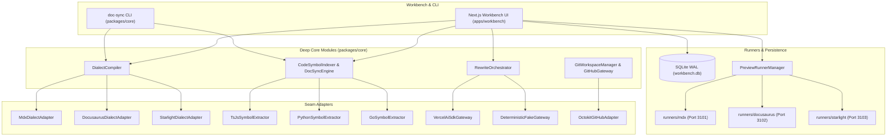

# Implementation Plan: `tech-docs` Platform (`LOCAL-TECH-DOCS-V1`)

## 1. Metadata

- **Execution Model**: Local-first single-tenant web workbench (Next.js App Router) + standalone CLI (`doc-sync`) + isolated pre-warmed documentation engine preview servers (`runners/{mdx,docusaurus,starlight}`).

### 1.1 Verified Environment Facts & Host Tooling

All tooling and package dependencies below were measured directly on the target host environment:

| Tool / Package       | Verified Version / SHA        | Verification Command                                             | Purpose in Architecture                                       |
| -------------------- | ----------------------------- | ---------------------------------------------------------------- | ------------------------------------------------------------- |
| Git Workspace        | 2 worktrees (`main`, `plans`) | `git -C /Users/darrenk/projects/bookend/tech-docs worktree list` | Worktree isolation for plan and source code                   |
| Node.js              | `v22.23.3`                    | `node -v`                                                        | Host runtime for monorepo and engines                         |
| npm                  | `10.9.9`                      | `npm -v`                                                         | Package management and workspace scripts                      |
| Bun                  | `1.4.3`                       | `bun -v`                                                         | Optional high-speed runner and test execution                 |
| GitHub CLI           | `2.102.1`                     | `gh --version`                                                   | Token resolution and PR workflow integration                  |
| Git                  | `2.54.0`                      | `git --version`                                                  | Shallow clones, branch management, worktree control           |
| `ai`                 | `7.0.152`                     | `npm view ai version`                                            | Core Vercel AI SDK runtime                                    |
| `@ai-sdk/google`     | `4.0.104`                     | `npm view @ai-sdk/google version`                                | Google Gemini model provider adapter                          |
| `unified`            | `11.0.5`                      | `npm view unified version`                                       | AST orchestration pipeline                                    |
| `remark-parse`       | `11.0.0`                      | `npm view remark-parse version`                                  | Markdown syntax tree parser                                   |
| `remark-mdx`         | `3.1.1`                       | `npm view remark-mdx version`                                    | MDX parser and JSX syntax node support                        |
| `remark-directive`   | `4.0.0`                       | `npm view remark-directive version`                              | Container, leaf, and text directive parsing (`:::note`, etc.) |
| `remark-frontmatter` | `5.0.0`                       | `npm view remark-frontmatter version`                            | YAML frontmatter parsing and normalization                    |
| `remark-stringify`   | `11.0.0`                      | `npm view remark-stringify version`                              | AST serializer for canonical and dialect output               |
| `web-tree-sitter`    | `0.27.1`                      | `npm view web-tree-sitter version`                               | Deterministic WASM-based code AST parser                      |
| `tree-sitter-wasms`  | `0.1.13`                      | `npm view tree-sitter-wasms version`                             | Precompiled TS/JS, Python, and Go grammars                    |
| `better-sqlite3`     | `13.0.3`                      | `npm view better-sqlite3 version`                                | Local persistent state and CAS job queue                      |
| `drizzle-orm`        | `0.45.4`                      | `npm view drizzle-orm version`                                   | Type-safe schema definition and query builder                 |
| `@octokit/rest`      | `22.0.1`                      | `npm view @octokit/rest version`                                 | GitHub REST client for PR creation and review comments        |
| `@docusaurus/core`   | `3.10.2`                      | `npm view @docusaurus/core version`                              | Docusaurus pre-warmed runner engine                           |
| `@astrojs/starlight` | `0.42.7`                      | `npm view @astrojs/starlight version`                            | Starlight pre-warmed runner engine                            |
| `@mdx-js/mdx`        | `3.1.1`                       | `npm view @mdx-js/mdx version`                                   | Standalone MDX compiler and validator                         |
| `next`               | `16.4.3`                      | `npm view next version`                                          | Full-stack Workbench application (App Router)                 |
| `vitest`             | `5.0.5`                       | `npm view vitest version`                                        | Unit and integration test runner                              |

---

## 2. Architecture & Deep Module Design

Every core subsystem is encapsulated as a **deep module**: presenting a narrow, stable **interface** while hiding substantial algorithmic **implementation** complexity behind explicit **seams** backed by at least two concrete **adapters** (production runtime + deterministic test fake or multiple dialect targets).



---

## 3. Concurrency, Serializability & Failure Lifecycle

Following §7, the system defines explicit concurrency guards, serializability guarantees, and failure transitions across all write paths:

### 3.1 SQLite Job & State Store (`.workspaces/workbench.db`)

The persistence tier uses `better-sqlite3@13.0.3` and `drizzle-orm@0.45.4`. On initialization, the connection executes:

```sql
PRAGMA journal_mode = WAL;
PRAGMA busy_timeout = 5000;
PRAGMA foreign_keys = ON;
PRAGMA synchronous = NORMAL;
```

#### Status Sentinels

Batch jobs and individual file progress rows use unambiguous status sentinels:
`'queued' | 'running' | 'completed' | 'failed' | 'cancelled'`
No status value is ever overloaded to represent more than one pending or transitioning state.

#### Compare-And-Swap (CAS) Transitions

To guarantee that two concurrent HTTP requests cannot double-start or double-process the same batch job, and that a stalled worker cannot overwrite a recovered job, all state transitions fence on `status` and `worker_id`:

1. **Lease Acquisition (`queued` -> `running`)**:

   ```sql
   UPDATE batch_jobs
   SET status = 'running',
       locked_at = strftime('%Y-%m-%dT%H:%M:%fZ', 'now'),
       lease_expires_at = strftime('%Y-%m-%dT%H:%M:%fZ', 'now', '+300 seconds'),
       worker_id = ?
   WHERE id = ? AND status = 'queued';
   ```

   If `changes === 0`, the caller receives a `409 Conflict` (`JobAlreadyStartedError`).

2. **Heartbeat Lease Renewal (every 30s)**:

   ```sql
   UPDATE batch_jobs
   SET lease_expires_at = strftime('%Y-%m-%dT%H:%M:%fZ', 'now', '+300 seconds'),
       updated_at = strftime('%Y-%m-%dT%H:%M:%fZ', 'now')
   WHERE id = ? AND status = 'running' AND worker_id = ?;
   ```

   If `changes === 0`, the worker lost its lease (e.g. stalled >300s and recovered) and immediately aborts in-flight work via `AbortController`.

3. **Terminal Completion / Failure (`running` -> `completed` | `failed`)**:
   ```sql
   UPDATE batch_jobs
   SET status = ?,
       error_code = ?,
       updated_at = strftime('%Y-%m-%dT%H:%M:%fZ', 'now')
   WHERE id = ? AND status = 'running' AND worker_id = ?;
   ```

#### Heartbeat Lease Expiry & Crash Recovery

- On Workbench server startup and before dispatching any queued job, the system executes an automated recovery sweep:
  ```sql
  UPDATE batch_jobs
  SET status = 'failed',
      error_code = 'WORKER_CRASH_EXPIRED',
      updated_at = strftime('%Y-%m-%dT%H:%M:%fZ', 'now')
  WHERE status = 'running'
    AND lease_expires_at < strftime('%Y-%m-%dT%H:%M:%fZ', 'now');
  ```
- Any failed attempt marks the row terminal with a descriptive reason. A lease is **never** renewed on a failed attempt, and jobs never remain stuck in `running` across crashes.

### 3.2 Repository Git Lock (`.workspaces/repos/<project-id>.lock`)

To prevent corrupted `.git/index.lock` collisions when multiple operations target the same repository clone:

- Every Git mutation (branch creation, commit, push, code-sync re-index, checkout) must acquire an async file lock using an `fcntl`/file-descriptor lockfile at `.workspaces/repos/<project-id>.lock`.
- Lock acquisition enforces a 30-second timeout. If the lock cannot be acquired within 30 seconds, the operation aborts with `GitLockTimeoutError`.
- Stale lock detection: if the process holding the lock dies, the OS releases the file descriptor automatically; PID check files are verified on boot.

### 3.3 Preview Content Atomic File Synchronization

To prevent concurrent file watcher thrashing in `runners/{mdx,docusaurus,starlight}` and avoid POSIX `ENOTEMPTY` directory rename failures:

- An in-memory async mutex (`runnerLocks.get(engine)`) serializes all write operations to the runner's `content/` directory.
- Inside the mutex, each file in `RenderedFileMap` is written to a sibling temporary file on the same filesystem (`content/<dir>/.tmp.<filename>.<nonce>`), flushed via `fsync`, and atomically renamed over the target path (`fs.rename(tmpPath, finalPath)`), which is guaranteed atomic by POSIX `rename(2)` for regular files.
- Any previously synced files in `content/` absent from the new `RenderedFileMap` are unlinked inside the same mutex pass, preserving the root `content/` directory inode so Docusaurus and Starlight chokidar watchers never lose their watch descriptors.

---

## 4. Deploy-Time Ordering & Local Runtime Lifecycle

The platform is designed as a local-first workbench and containerized service. There are no cloud-provider deployment dependencies or external managed services required in v1.

### 4.1 Local & Container Startup Lifecycle

1. **Build & Package Compilation (Production / Container Mode)**:
   - In production/container builds, `@tech-docs/core` and `@tech-docs/workbench` must be compiled in dependency order (`npm run build --workspace=@tech-docs/core && npm run build --workspace=@tech-docs/workbench`, which runs `next build`) before starting the server. In local development mode (`npm run dev`), `next dev` compiles routes on demand against workspace TypeScript sources.
2. **Filesystem Workspace Initialization**:
   - Creates `.workspaces/workbench.db`, `.workspaces/repos/`, and `.workspaces/cache/` directories.
3. **SQLite Schema Migration**:
   - Executes idempotent Drizzle migrations on `.workspaces/workbench.db` synchronously during application boot _before_ accepting any HTTP connections.
   - Executes crash recovery query to mark stale leases as `failed` (`WORKER_CRASH_EXPIRED`).
4. **Runner Dependency Pre-Warming**:
   - Verifies that `runners/mdx`, `runners/docusaurus`, and `runners/starlight` have their dependencies installed (`node_modules`).
   - If missing, triggers initial workspace installation.
5. **Server Listening**:
   - Starts Next.js server (`next start --port 3000` in production/container mode, or `next dev --port 3000` in local dev mode).

---

## 5. Declined Structural Remedies

The following architectural alternatives were evaluated and are declined:

1. **Declined: External Redis & BullMQ Queue for Batch Jobs**
   - _Rationale_: Adds an external daemon dependency, violating the local-first, zero-setup developer experience.
   - _Chosen Approach_: SQLite in WAL mode with `busy_timeout = 5000` and CAS atomic state updates (`UPDATE ... WHERE status = 'queued'`). This provides full serializability and persistence within a single local database file.
2. **Declined: Native C++ Tree-Sitter Bindings (`node-tree-sitter`)**
   - _Rationale_: Requires native C++ compilation (`node-gyp`, Python, Xcode/build-essential) on user machines, which frequently breaks across OS versions and architectures (ARM64 vs. x86_64).
   - _Chosen Approach_: `web-tree-sitter@0.27.1` with precompiled WASM grammars (`tree-sitter-wasms@0.1.13`), ensuring 100% portable, deterministic offline parsing across macOS, Linux, and Windows.
3. **Declined: Simulated In-Memory CSS Preview Instead of Engine Runners**
   - _Rationale_: Approximating Docusaurus or Starlight styling via standard Tailwind CSS produces preview fidelity gaps (broken custom components, missing tab logic, unrendered admonitions).
   - _Chosen Approach_: Isolated pre-warmed dev servers (`runners/{mdx,docusaurus,starlight}`) embedded in iframes, providing 100% exact preview fidelity identical to real deployment.
4. **Declined: Direct In-Memory AST Mutation on Master Repo Clone**
   - _Rationale_: Concurrent user operations or crashes mid-rewrite would leave the Git working tree dirty or corrupted.
   - _Chosen Approach_: Git worktree and file lock isolation with per-file atomic write-and-rename synchronization.
